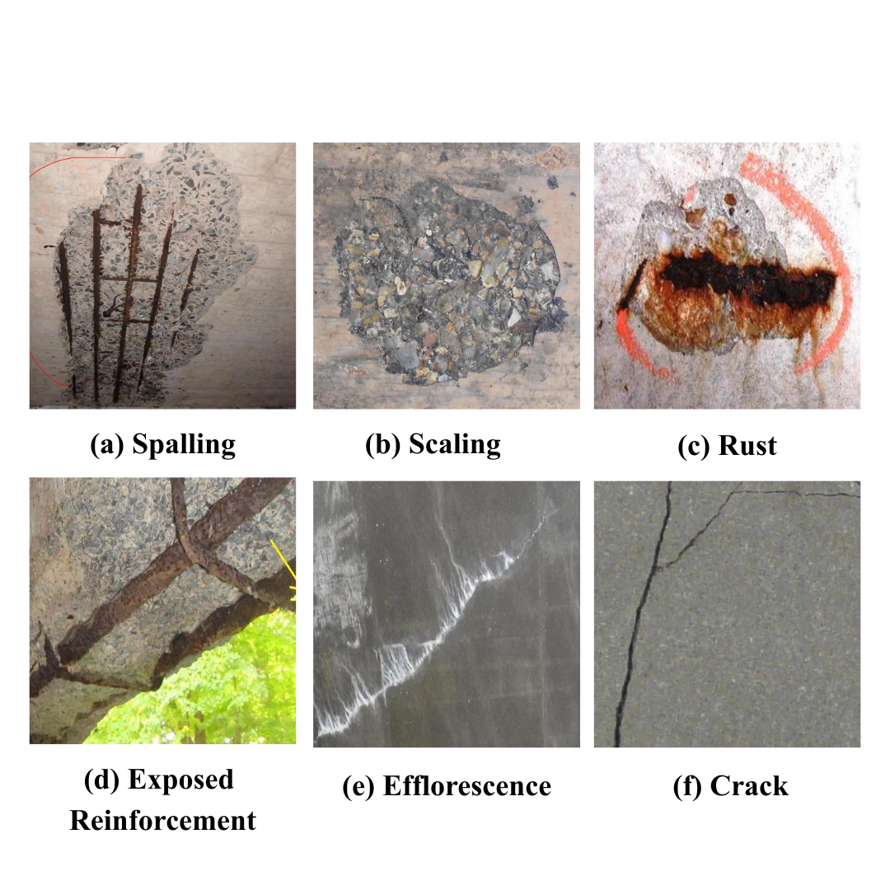
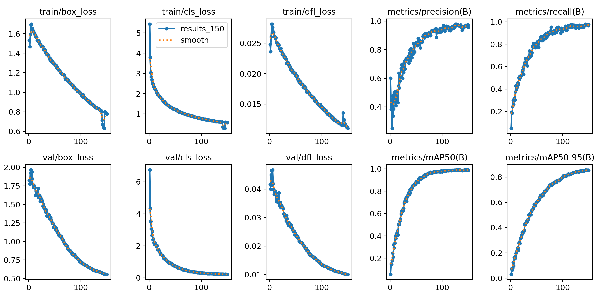
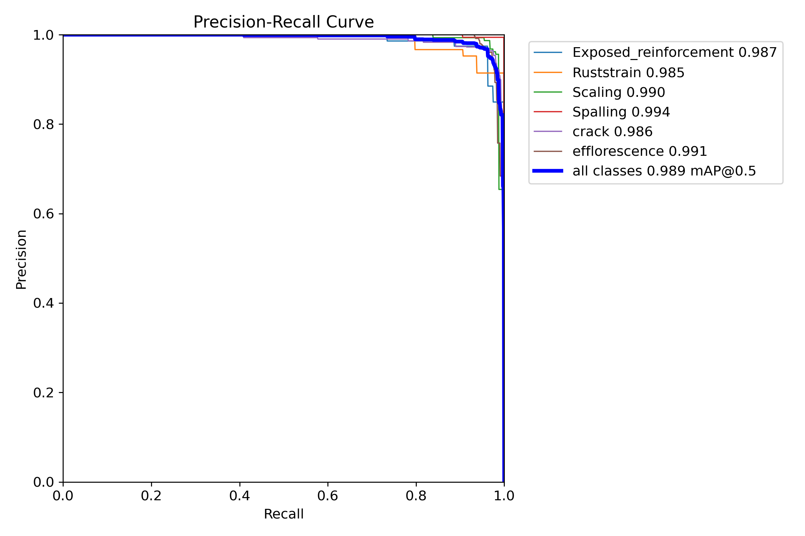

# Concrete Surface Deterioration Detection and Classification Using YOLO26n

Code, trained model and results for the paper:

> **Akter, S. T.**, Lamun, S. S., Zisan, M. B., & Rahman, M. A. (2026). Concrete surface deterioration detection and classification using YOLO26n: An AI-driven approach. *Scientific Reports*. [https://doi.org/10.1038/s41598-026-68706-0](https://doi.org/10.1038/s41598-026-68706-0)

A lightweight **YOLO26n** object detector (2.4M parameters, 5.2 GFLOPs) finds and classifies six kinds of concrete surface damage in photographs. It is meant for fast, low-cost inspection of civil infrastructure.



## Defect classes

Exposed reinforcement · Rust stain · Scaling · Spalling · Crack · Efflorescence

## Results

YOLO26n trained for 150 epochs on a 70 / 15 / 15 train / validation / test split (6,806 images, 640×640), on one Tesla T4 GPU. Validation results for the best checkpoint (1,021 images, 2,195 labeled defects):

| Class | Precision | Recall | mAP@50 | mAP@50–95 |
|---|---|---|---|---|
| **All** | **0.970** | **0.957** | **0.988** | **0.841** |
| Exposed reinforcement | 0.980 | 0.927 | 0.990 | 0.821 |
| Rust stain | 0.944 | 0.902 | 0.978 | 0.758 |
| Scaling | 0.991 | 0.987 | 0.995 | 0.905 |
| Spalling | 0.989 | 1.000 | 0.992 | 0.911 |
| Crack | 0.948 | 0.955 | 0.984 | 0.811 |
| Efflorescence | 0.969 | 0.972 | 0.991 | 0.840 |

Inference takes about 2.8 ms per image on the T4.

| Training curves | Precision–recall curve |
|---|---|
|  |  |

## Repository structure

```
notebooks/
  yolov26_training.ipynb        Main training notebook
  train_70_split_run.ipynb      Training run on the 70/15/15 split
  colab/70_train_split.ipynb    Colab run, 70/15/15 split
  colab/80_train_split.ipynb    Colab run, 80% training split
  train_val_loss.ipynb          Training and validation loss plots
  confusion_matrix_plot.ipynb   Confusion matrix figure
weights/best.pt                 Trained YOLO26n model (best checkpoint)
results/                        Per-epoch metrics (results_150.csv), confusion matrices,
                                curves and sample predictions for the 80% split run
figures/                        Figures 1–9 of the paper
data/data.yaml                  Dataset configuration (class names, split folders)
```

## Dataset

The images are not stored here. The dataset is public on Roboflow Universe under **CC BY 4.0**:
[Concrete Defect Detection (v2)](https://universe.roboflow.com/lexo-qpwz7/concrete-defect-detection-zuym8-u3uvi/dataset/2).

Download it in YOLO format and point `data/data.yaml` to the `train`, `valid` and `test` folders. The notebooks that download it with the Roboflow API need your own key in place of `YOUR_ROBOFLOW_API_KEY`.

## Using the trained model

```bash
pip install ultralytics
```

```python
from ultralytics import YOLO

model = YOLO("weights/best.pt")
results = model.predict("path/to/concrete_photo.jpg", conf=0.25)
results[0].show()
```

## Citation

```bibtex
@article{akter2026yolo26n,
  title   = {Concrete surface deterioration detection and classification using YOLO26n: An AI-driven approach},
  author  = {Akter, Syeda Tamzida and Lamun, Sayed Shahriar Islam and Zisan, Md. Basir and Rahman, M. A.},
  journal = {Scientific Reports},
  year    = {2026},
  doi     = {10.1038/s41598-026-68706-0}
}
```

Dataset: Lamun, S. S. I. (2025). *Concrete Defect Detection Dataset*. Roboflow Universe.
